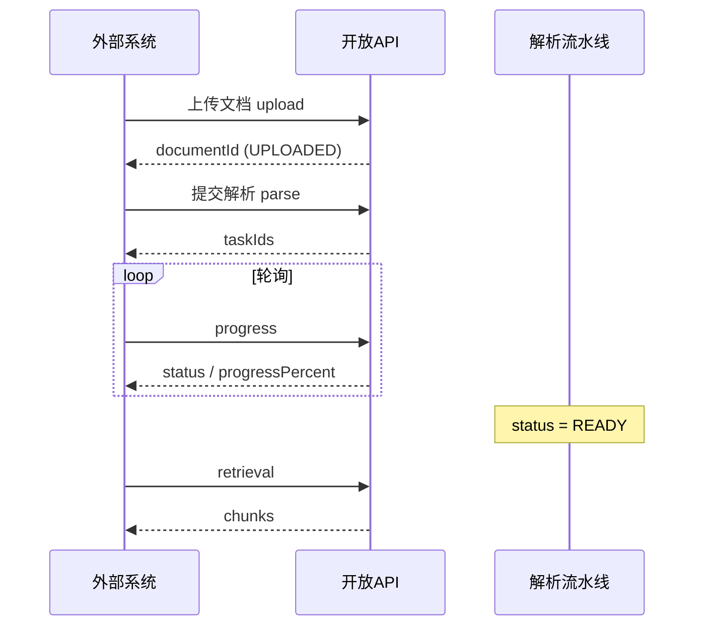

# 知识库开放 API 接口文档

> 面向外部系统对接 / 系统内「开放 API」说明页。前端可直接渲染本 Markdown。  
> Controller：`KbOpenApiController` · 前缀：`/gpt/open/v1/kb`  
> 鉴权：**API Key**（`Authorization: Bearer kb-xxx`），无需登录 JWT。  
> 密钥在系统内创建，见：[知识库API密钥管理接口文档.md](./知识库API密钥管理接口文档.md)。

---

## 目录

1. [快速开始](#1-快速开始)
2. [鉴权](#2-鉴权)
3. [全局约定](#3-全局约定)
4. [知识库接口](#4-知识库接口)
5. [文档接口](#5-文档接口)
6. [分块接口](#6-分块接口)
7. [召回接口](#7-召回接口)
8. [推荐对接流程](#8-推荐对接流程)
9. [错误码](#9-错误码)
10. [接口一览表](#10-接口一览表)

---

## 1. 快速开始

| 项目 | 值 |
|------|----|
| Base URL（经网关） | `http://{gateway}/gpt/open/v1/kb` |
| 本地示例 | `http://localhost:13001/gpt/open/v1/kb` |
| 密钥格式 | `kb-` 开头，创建时仅展示一次 |
| Content-Type | 多数为 `application/json`；上传为 `multipart/form-data` |

**最小召回示例**：

```bash
curl -X POST 'http://localhost:13001/gpt/open/v1/kb/retrieval' \
  -H 'Authorization: Bearer kb-your-api-key' \
  -H 'Content-Type: application/json' \
  -d '{
    "question": "退货流程是什么？",
    "dataset_ids": ["知识库ID"]
  }'
```

---

## 2. 鉴权

每个开放接口请求头：

```http
Authorization: Bearer kb-xxxxxxxx
Content-Type: application/json
X-User-Id: optional-external-user-id
```

| Header | 必填 | 说明 |
|--------|------|------|
| `Authorization` | **是** | `Bearer` + API Key 明文 |
| `X-User-Id` | 否 | 外部用户标识，默认 `default`（审计/追踪用） |
| `Content-Type` | 视接口 | JSON 或 multipart |

> 不要把 API Key 写进 URL Query；不要提交到前端公开仓库。

---

## 3. 全局约定

### 3.1 成功响应 `Result<T>`

```json
{
  "code": 200,
  "message": null,
  "data": {}
}
```

| code | 含义 |
|------|------|
| `200` | 成功 |
| `10002` | 业务失败（部分业务异常走此结构；鉴权失败多为 HTTP 401/403） |

### 3.2 分页 `PageResult<T>`

```json
{
  "total": 100,
  "page": 1,
  "size": 20,
  "records": []
}
```

### 3.3 文档状态（解析链路）

```
UPLOADED → PARSING → PARSED → CHUNKING → EMBEDDING → INDEXING → READY
```

| 状态 | 说明 |
|------|------|
| `UPLOADED` | 已上传，待解析 |
| `PARSING` / `PARSED` / `CHUNKING` / `EMBEDDING` / `INDEXING` | 处理中 |
| `READY` | 可检索 |
| `FAILED` | 失败 |
| `CANCELLED` | 已取消 |

进度字段 `progressPercent`：`0~100`；失败/取消多为 `-1`。

---

## 4. 知识库接口

### 4.1 创建 / 修改知识库

| 项目 | 值 |
|------|----|
| Method | `POST` |
| Path | `/gpt/open/v1/kb/datasets` |

**请求体**（创建不传 `id`；修改传 `id`）：

```json
{
  "id": null,
  "name": "产品手册库",
  "description": "对外对接用",
  "treeId": null,
  "embeddingModel": "Qwen/Qwen3-Embedding-4B",
  "chunkSize": 512,
  "chunkOverlap": 64,
  "parserType": "native",
  "chunkStrategy": "naive",
  "status": "ACTIVE"
}
```

| 字段 | 类型 | 必填 | 说明 |
|------|------|------|------|
| id | string | 修改时必填 | 有值=更新，无值=新建 |
| name | string | 创建时必填 | 知识库名称 |
| description | string | 否 | 描述 |
| treeId | string | 否 | 分类树 ID |
| embeddingModel | string | 否 | Embedding 模型标识 |
| chunkSize | int | 否 | 默认 512 |
| chunkOverlap | int | 否 | 默认 64 |
| parserType | string | 否 | `native` / `ocr` / `mineru` |
| chunkStrategy | string | 否 | 如 `naive`（默认） |
| status | string | 否 | `ACTIVE` / `DISABLED` |

**限制**：若 Key 配置了 `datasetIds` 白名单，则**禁止创建**新知识库（仅可改白名单内库）。

---

### 4.2 知识库详情

| 项目 | 值 |
|------|----|
| Method | `GET` |
| Path | `/gpt/open/v1/kb/datasets/{id}` |
---

### 4.3 知识库列表

| 项目 | 值 |
|------|----|
| Method | `GET` |
| Path | `/gpt/open/v1/kb/datasets` |
| Query | 类型 | 必填 | 说明 |
|-------|------|------|------|
| name | string | 否 | 名称模糊 |
| treeId | string | 否 | 分类过滤 |

自动按租户 + Key 白名单过滤。

---

### 4.4 知识库分页

| 项目 | 值 |
|------|----|
| Method | `POST` |
| Path | `/gpt/open/v1/kb/datasets/page` |

**请求体**：

```json
{
  "name": "",
  "treeId": null,
  "status": "ACTIVE",
  "page": 1,
  "size": 20
}
```

**data 项字段**（`DatasetListItemVo`）：

| 字段 | 说明 |
|------|------|
| id / name / treeId / description | 基本信息 |
| embeddingModel / chunkStrategy / parserType / status | 配置 |
| createTime | 创建时间 |
| documentCount / chunkCount | 文档数 / 分块数 |

---

### 4.5 删除知识库

| 项目 | 值 |
|------|----|
| Method | `DELETE` |
| Path | `/gpt/open/v1/kb/datasets/{id}` |
> 会级联清理文档、分块及相关索引，请谨慎调用。

---

## 5. 文档接口

### 5.1 文档列表

| 项目 | 值 |
|------|----|
| Method | `GET` |
| Path | `/gpt/open/v1/kb/datasets/{datasetId}/documents` |
---

### 5.2 文档分页

| 项目 | 值 |
|------|----|
| Method | `GET` |
| Path | `/gpt/open/v1/kb/datasets/{datasetId}/documents/page` |
| Query | 默认 | 说明 |
|-------|------|------|
| keyword | - | 文件名关键词 |
| page | 1 | 页码 |
| size | 20 | 每页条数 |

**分页项主要字段**：

| 字段 | 说明 |
|------|------|
| id / datasetId / fileName / fileType / fileSize | 文件信息 |
| status / progressPercent / progressMessage / errorMessage | 处理状态 |
| chunkCount | 分块数 |
| searchEnabled | 是否参与召回 |
| createTime | 创建时间 |

---

### 5.3 上传文档

| 项目 | 值 |
|------|----|
| Method | `POST` |
| Path | `/gpt/open/v1/kb/datasets/{datasetId}/documents/upload` |
| Content-Type | `multipart/form-data` |

| Part | 必填 | 说明 |
|------|------|------|
| file | 是 | 文件本体 |

**说明**：上传成功后状态为 `UPLOADED`，**不会自动解析**，需再调「提交解析」。

```bash
curl -X POST 'http://localhost:13001/gpt/open/v1/kb/datasets/{datasetId}/documents/upload' \
  -H 'Authorization: Bearer kb-your-api-key' \
  -F 'file=@./手册.pdf'
```

### 5.3.1 批量上传文档

| 项目 | 值 |
|------|----|
| Method | `POST` |
| Path | `/gpt/open/v1/kb/datasets/{datasetId}/documents/upload/batch` |
| Content-Type | `multipart/form-data` |

| 参数 | 位置 | 类型 | 必填 | 说明 |
|------|------|------|------|------|
| datasetId | Path | string | 是 | 当前 API Key 有权访问的知识库 ID |
| files | Part | file[] | 是 | 多个文件，使用重复的 `files` Part；不能使用单文件接口的 `file` 字段 |

```bash
curl -X POST 'http://localhost:13001/gpt/open/v1/kb/datasets/{datasetId}/documents/upload/batch' \
  -H 'Authorization: Bearer kb-your-api-key' \
  -F 'files=@./手册.pdf' \
  -F 'files=@./说明.docx'
```

使用 `curl -F` 时由 cURL 自动生成 multipart 的 Content-Type 和 boundary，不要手工设置为 `application/json`。

**响应 data 示例**（`DocumentBatchUploadResultVo`）：

```json
{
  "total": 2,
  "succeeded": 1,
  "failed": 1,
  "items": [
    {"fileName": "手册.pdf", "documentId": "doc-1", "success": true, "message": null},
    {"fileName": "说明.docx", "documentId": null, "success": false, "message": "上传失败原因"}
  ]
}
```

| 字段 | 说明 |
|------|------|
| total / succeeded / failed | 请求文件数 / 上传成功数 / 上传失败数 |
| items[].fileName | 原始文件名 |
| items[].documentId | 上传成功后的文档 ID，后续用于提交解析和查询进度 |
| items[].success / message | 单个文件的上传结果 / 失败原因 |

单个文件上传失败不影响其余文件；即使外层 `code=200`，也要检查 `items[].success`。
上传成功的文档状态为 `UPLOADED`，**不会自动解析**。取成功项的 `documentId` 调用单文件或批量提交解析接口。

---

### 5.4 删除文档

| 项目 | 值 |
|------|----|
| Method | `DELETE` |
| Path | `/gpt/open/v1/kb/documents/{documentId}` |
---

### 5.5 提交文档解析（异步）

| 项目 | 值 |
|------|----|
| Method | `POST` |
| Path | `/gpt/open/v1/kb/documents/{documentId}/parse` |
| Query | 默认 | 说明 |
|-------|------|------|
| force | false | `true` 强制重新解析 |

**响应 data**（`DocumentParseSubmitVo`）：

```json
{
  "documentId": "xxx",
  "taskIds": ["task-1"],
  "skipped": false,
  "message": "已提交解析任务"
}
```

| 字段 | 说明 |
|------|------|
| taskIds | 已入队任务 ID |
| skipped | `true` 表示未新建任务（例如已 READY 且配置未变） |
| message | 说明文案 |

接口**立即返回**，不等待解析完成；请轮询进度接口。

```bash
curl -X POST 'http://localhost:13001/gpt/open/v1/kb/documents/{documentId}/parse?force=false' \
  -H 'Authorization: Bearer kb-your-api-key'
```


### 5.5.1 批量提交文档解析（异步）

| 项目 | 值 |
|------|----|
| Method | `POST` |
| Path | `/gpt/open/v1/kb/documents/parse/batch` |
| Content-Type | `application/json` |

| 字段 | 类型 | 必填 | 说明 |
|------|------|------|------|
| documentIds | string[] | 是 | 已上传的文档 ID 列表；忽略 null 和空白 ID，去除首尾空格、去重后逐个提交；无有效 ID 时返回 400 |
| force | boolean | 否 | 默认 `false`，按文件和配置判断增量复用；`true` 强制全量重新解析 |

```bash
curl -X POST 'http://localhost:13001/gpt/open/v1/kb/documents/parse/batch' \
  -H 'Authorization: Bearer kb-your-api-key' \
  -H 'Content-Type: application/json' \
  -d '{"documentIds":["doc-1","doc-2","doc-3"],"force":false}'
```

**响应 data 示例**（`DocumentBatchParseResultVo`）：

```json
{
  "total": 3,
  "submitted": 2,
  "failed": 1,
  "items": [
    {"documentId": "doc-1", "taskIds": ["task-1"], "skipped": false, "message": "已提交解析任务"},
    {"documentId": "doc-2", "taskIds": [], "skipped": true, "message": "配置未变且文档已 READY，未创建任务"}
  ],
  "failures": [
    {"documentId": "doc-3", "message": "解析任务提交失败原因"}
  ]
}
```

| 字段 | 说明 |
|------|------|
| total | 去重、去除空白 ID 后的文档数 |
| submitted | 成功提交数，**包含 skipped=true 的文档** |
| failed / failures | 提交失败数 / 失败文档 ID 与原因 |
| items[].documentId / taskIds | 成功处理的文档 ID / 已创建任务 ID 列表 |
| items[].skipped / message | 是否未创建新任务 / 本次处理说明 |

接口先校验整批文档权限；存在无权访问或不存在的文档时，本次请求整体拒绝，不提交部分任务。
权限校验通过后，单篇文档提交失败会记录在 `failures`，不影响其他文档；外层成功不代表每项提交成功。

**异步返回不代表解析完成**。对成功提交的文档分别调用
`GET /gpt/open/v1/kb/documents/{documentId}/progress`，轮询至 `READY`、`FAILED` 或 `CANCELLED`。
`skipped=true` 表示未创建新任务，应结合 `message` 和文档状态判断。

---

### 5.6 获取解析进度和状态

| 项目 | 值 |
|------|----|
| Method | `GET` |
| Path | `/gpt/open/v1/kb/documents/{documentId}/progress` |

**响应 data**（`DocumentProgressVo`）：

```json
{
  "documentId": "xxx",
  "status": "INDEXING",
  "progressPercent": 80,
  "progressMessage": "索引写入中",
  "errorMessage": null,
  "taskStatus": "RUNNING",
  "retryCount": 0,
  "taskError": null
}
```

| 字段 | 说明 |
|------|------|
| status | 文档处理状态 |
| progressPercent | `0~100`；失败/取消多为 `-1` |
| progressMessage | 进度文案 |
| errorMessage | 文档失败原因 |
| taskStatus | 任务状态 |
| retryCount / taskError | 任务重试与错误 |

**前端轮询建议**：每 2~3 秒一次，直到 `status=READY` 或 `FAILED` / `CANCELLED`。

---

## 6. 分块接口

### 6.1 文档分块列表

| 项目 | 值 |
|------|----|
| Method | `GET` |
| Path | `/gpt/open/v1/kb/documents/{documentId}/chunks` |
返回 `ChunkVo[]`，主要字段：

| 字段 | 说明 |
|------|------|
| id / datasetId / documentId | 标识 |
| chunkType | `text` / `image` / `mixed` |
| content / contentPreview | 内容 |
| chunkIndex / tokenSize | 序号与 token |
| pageStart / pageEnd | 页码范围 |
| available | 是否可检索 |
| tags / importantKeywords / questions | 增强字段 |

---

### 6.2 文档分块分页

| 项目 | 值 |
|------|----|
| Method | `GET` |
| Path | `/gpt/open/v1/kb/documents/{documentId}/chunks/page` |
| Query | 默认 |
|-------|------|
| page | 1 |
| size | 20 |

---

### 6.3 文档分块拼接文本

| 项目 | 值 |
|------|----|
| Method | `GET` |
| Path | `/gpt/open/v1/kb/documents/{documentId}/text` |

按 `chunkIndex` 从小到大，把各分块 `content` 用两个换行拼成 `text`。分块之间的重叠不会去掉。文档状态不是 `READY` 时，`text` 为空字符串，`chunks` 为空数组，`status` 仍返回当前状态。

鉴权与其他开放接口相同，只校验 `Authorization: Bearer kb-xxx`。

单次 `text` 最多 1000000 个字符。正式环境分块列表单次最多取 10000 条。超出任一上限时 `truncated=true`，只返回已拼进 `text` 的分块；最后一块的 `content` 可能只是原文前缀。

```json
{
  "code": 200,
  "message": null,
  "data": {
    "documentId": "doc-1",
    "datasetId": "ds-1",
    "fileName": "产品手册.pdf",
    "fileType": "pdf",
    "status": "READY",
    "documentVersion": 1,
    "chunkCount": 2,
    "charCount": 12,
    "truncated": false,
    "text": "第一段正文\n\n第二段正文",
    "chunks": [
      {
        "id": "chunk-1",
        "chunkIndex": 0,
        "chunkType": "text",
        "pageStart": 1,
        "pageEnd": 1,
        "tokenSize": 120,
        "charStart": 0,
        "charEnd": 5,
        "content": "第一段正文"
      },
      {
        "id": "chunk-2",
        "chunkIndex": 1,
        "chunkType": "text",
        "pageStart": 2,
        "pageEnd": 2,
        "tokenSize": 80,
        "charStart": 7,
        "charEnd": 12,
        "content": "第二段正文"
      }
    ]
  }
}
```

| 字段 | 说明 |
|------|------|
| documentId / datasetId / fileName / fileType | 文档标识与文件信息 |
| status | 文档处理状态。非 `READY` 时不返回正文 |
| documentVersion | 当前文档版本 |
| chunkCount | 本次返回并参与拼接的分块数 |
| charCount | `text` 的字符数 |
| truncated | 是否因长度或分块条数上限未返回全文 |
| text | 分块 `content` 按序号拼接的结果 |
| chunks[].charStart / charEnd | 该分块在 `text` 中的区间，`charEnd` 不含 |
| chunks[].content | 写入 `text` 的正文 |

---

### 6.4 文档解析图片列表

| 项目 | 值 |
|------|----|
| Method | `GET` |
| Path | `/gpt/open/v1/kb/documents/{documentId}/images` |

**响应：** `DocumentImageListVo`（`total` + `records[]`）。`total` 为去重后张数。优先读媒体资产表，表为空再从分块 `mediaAssets` 按 `assetId` 去重。原图仍走 `GET /gpt/kb/media/preview/{assetId}`。

```json
{
  "total": 2,
  "records": [
    {
      "assetId": "...",
      "previewUrl": "/gpt/kb/media/preview/...",
      "caption": "...",
      "ocrText": "...",
      "width": 1200,
      "height": 800
    }
  ]
}
```

---

## 7. 召回接口

### 7.1 知识库召回

| 项目 | 值 |
|------|----|
| Method | `POST` |
| Path | `/gpt/open/v1/kb/retrieval` |

**请求体**（字段对齐 RAGFlow，兼容 camelCase）：

```json
{
  "question": "如何申请退款？",
  "dataset_ids": ["知识库ID1", "知识库ID2"],
  "document_ids": [],
  "page": 1,
  "page_size": 10,
  "top_k": 20,
  "similarity_threshold": 0.2,
  "vector_similarity_weight": 0.7,
  "keyword": true,
  "hybrid_enabled": true,
  "rerank_enabled": true,
  "highlight": true
}
```

| 字段 | 类型 | 必填 | 说明 |
|------|------|------|------|
| question | string | 是 | 查询问题（也兼容 `query`） |
| dataset_ids | string[] | 是* | 知识库 ID 列表 |
| dataset_id | string | 是* | 单库时可用（与 dataset_ids 二选一或同时） |
| document_ids | string[] | 否 | 限定文档 |
| page | int | 否 | 默认 1 |
| page_size | int | 否 | 默认 30 |
| top_k | int | 否 | 召回候选规模，默认 20 |
| similarity_threshold | number | 否 | 相似度阈值，默认 0.2 |
| vector_similarity_weight | number | 否 | 向量权重 0~1 |
| keyword / hybrid_enabled | boolean | 否 | 关键词 / 混合检索 |
| rerank_enabled | boolean | 否 | 是否 Rerank，默认 true |
| highlight | boolean | 否 | 是否高亮 |
| tags | string[] | 否 | 标签过滤 |

\* `dataset_ids` 与 `dataset_id` 至少提供一个，且须在 Key 可访问范围内。

**响应 data**（`RetrievalResponseData`）：

```json
{
  "chunks": [
    {
      "chunk_id": "c1",
      "dataset_id": "d1",
      "document_id": "doc1",
      "document_name": "手册.pdf",
      "content": "...",
      "score": 0.86,
      "vector_similarity": 0.9,
      "term_similarity": 0.7,
      "highlight": "<em>退款</em>...",
      "page_start": 3,
      "page_end": 3,
      "chunk_type": "text",
      "media_assets": []
    }
  ],
  "doc_aggs": [],
  "total": 12
}
```

| 字段 | 说明 |
|------|------|
| chunks | 命中分块列表 |
| doc_aggs | 按文档聚合统计 |
| total | 命中总数（分页前） |

---

## 8. 推荐对接流程



文字步骤：

1. 在系统内创建 API Key 并保存明文  
2. （可选）创建知识库，或使用已有 `datasetId`  
3. `upload` 上传单文件，或 `upload/batch` 批量上传；保留上传成功的文档 ID
4. `parse` 提交单文件解析，或 `documents/parse/batch` 批量提交解析；检查逐项结果
5. 轮询 `progress` 直至 `READY`  
6. `retrieval` 召回；需要整篇可读原文时再调 `documents/{documentId}/text`，只要分块明细时调 `chunks`

---

## 9. 错误码

| HTTP | 场景 |
|------|------|
| 400 | 参数错误、业务校验失败 |
| 401 | 缺少 Bearer Key；Key 无效 / 禁用 / 过期 |
| 403 | 跨租户；不在 datasetIds 白名单；白名单 Key 创建新库 |
| 404 | 知识库 / 文档 / 分块不存在 |
| 500 | 服务内部错误 |

鉴权失败时 message 示例：

- `Authorization Bearer API Key 不能为空`
- `API Key 无效`
- `API Key 已禁用`
- `API Key 已过期`
- `API Key 无权访问该知识库`

---

## 10. 接口一览表

| 方法 | 路径 | 说明 |
|------|------|------|
| POST | `/datasets` | 创建/修改知识库 |
| GET | `/datasets/{id}` | 知识库详情 |
| GET | `/datasets` | 知识库列表 |
| POST | `/datasets/page` | 知识库分页 |
| DELETE | `/datasets/{id}` | 删除知识库 |
| GET | `/datasets/{datasetId}/documents` | 文档列表 |
| GET | `/datasets/{datasetId}/documents/page` | 文档分页 |
| POST | `/datasets/{datasetId}/documents/upload` | 上传文档 |
| POST | `/datasets/{datasetId}/documents/upload/batch` | 批量上传文档（不自动解析） |
| DELETE | `/documents/{documentId}` | 删除文档 |
| POST | `/documents/{documentId}/parse` | 提交解析 |
| POST | `/documents/parse/batch` | 批量提交解析（异步） |
| GET | `/documents/{documentId}/progress` | 解析进度 |
| GET | `/documents/{documentId}/text` | 分块拼接文本 |
| GET | `/documents/{documentId}/chunks` | 分块列表 |
| GET | `/documents/{documentId}/chunks/page` | 分块分页 |
| GET | `/documents/{documentId}/images` | 解析图片列表 |
| POST | `/retrieval` | 知识库召回 |

> 上表路径均相对于 Base：`/gpt/open/v1/kb`。

---

## 附录：完整 cURL 套件

```bash
BASE='http://localhost:13001/gpt/open/v1/kb'
KEY='kb-your-api-key'

# 创建知识库
curl -X POST "$BASE/datasets" \
  -H "Authorization: Bearer $KEY" -H 'Content-Type: application/json' \
  -d '{"name":"对接测试库","chunkStrategy":"naive"}'

# 上传
curl -X POST "$BASE/datasets/{datasetId}/documents/upload" \
  -H "Authorization: Bearer $KEY" -F 'file=@./demo.pdf'

# 批量上传（重复 files 字段）
curl -X POST "$BASE/datasets/{datasetId}/documents/upload/batch" \
  -H "Authorization: Bearer $KEY" \
  -F 'files=@./demo.pdf' -F 'files=@./guide.docx'

# 解析
curl -X POST "$BASE/documents/{documentId}/parse?force=false" \
  -H "Authorization: Bearer $KEY"

# 批量提交解析（使用上传成功返回的 documentId）
curl -X POST "$BASE/documents/parse/batch" \
  -H "Authorization: Bearer $KEY" -H 'Content-Type: application/json' \
  -d '{"documentIds":["doc-1","doc-2"],"force":false}'

# 进度
curl "$BASE/documents/{documentId}/progress" \
  -H "Authorization: Bearer $KEY"

# 分块拼接文本
curl "$BASE/documents/{documentId}/text" \
  -H "Authorization: Bearer $KEY"

# 分块
curl "$BASE/documents/{documentId}/chunks?page=1&size=20" \
  -H "Authorization: Bearer $KEY"

# 解析图片
curl "$BASE/documents/{documentId}/images" \
  -H "Authorization: Bearer $KEY"

# 召回
curl -X POST "$BASE/retrieval" \
  -H "Authorization: Bearer $KEY" -H 'Content-Type: application/json' \
  -d '{"question":"你好","dataset_ids":["{datasetId}"],"page_size":5}'
```
